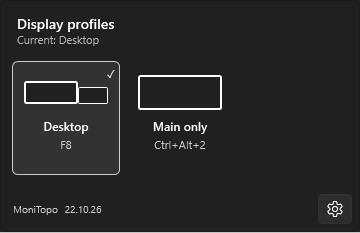
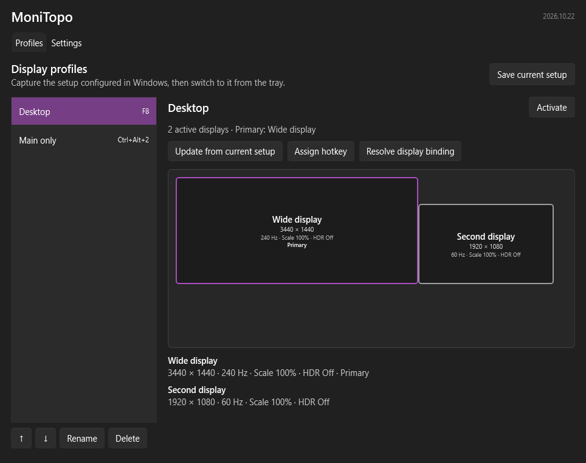

# MoniTopo

MoniTopo is a Windows tray application for saving and switching complete display configurations. A profile records the active displays, topology, positions, primary display, resolution, refresh rate, orientation, Windows UI scale, and HDR state.

Windows 11 x64 is the supported target. Windows 10 support is best effort. Display scaling support is runtime-probed because Windows does not publish the per-monitor scaling setter as a stable public contract. MoniTopo does not change brightness or vendor-specific graphics settings.

## Screenshots

Tray popup with saved-layout schematics and hotkeys:



Main window with profile actions and a read-only display preview:



Screenshots use example profiles, not captured hardware identifiers. Light and system-following themes are also available.

## Installation and use

Download [the latest release](https://github.com/niposch/MoniTopo/releases/latest): choose `MoniTopo-win-Setup.exe` for the per-user installer or `MoniTopo-win-Portable.zip` for a portable copy. The installer requires no administrator rights. It is not code-signed, so Windows SmartScreen may show an unknown-publisher warning.

On first run, choose whether MoniTopo should start when you sign in, then capture the setup currently configured in Windows as a named profile. Activate saved profiles from the tray popup or an assigned hotkey. MoniTopo starts in the tray by default; the main window can be enabled at launch in General settings.

The tray popup shows each saved layout, name, and hotkey. It opens beside the primary monitor's notification area, independent of the pointer position. **Settings → Open tray popup** changes its global shortcut (default **Ctrl+Alt+M**). Single-key shortcuts are allowed after confirmation because they intercept that key in other applications. Profile hotkeys also appear in the main profile list.

In the main window, select a profile and choose **Edit display settings** to change resolution, refresh rate, HDR, and Windows scale using available-option dropdowns. Refresh choices follow the selected resolution. **Save profile** only saves; choose **Activate** separately to apply it. Resolution changes keep connected monitor edges together without a layout editor. Disconnected or inactive displays keep their saved values until Windows can report their options. For cloned displays, change the shared mode and scale in Windows and use **Update from current setup**; HDR remains editable per display. This editor is in development and is not included in release 22.10.26.

Choose **System**, **Light**, or **Dark** under **Settings → General → Theme**. The choice applies immediately to MoniTopo and is remembered; it does not change the Windows theme.

Display activation requires an explicit click/hotkey and `MONITOPO_ALLOW_REAL_DISPLAY_CHANGES=1` in the app's environment. Set that user environment variable yourself and restart MoniTopo before switching profiles. Without it, capture and preview work, but activation is disabled. Starting the application never applies a profile automatically. See the [safety boundary](docs/development.md#safety-boundary) for details.

Installed builds check stable releases at most once per day when enabled. Choose **Release notes** in the tray update row or **Settings → Updates** to read the available version's notes before deciding. Reading notes does not download anything. MoniTopo does not download an update until **Download update** is selected. A staged update can be applied immediately with **Restart now**, or automatically the next time MoniTopo starts.

Current limitations include the runtime-probed Windows scale contract, ambiguous identical monitors requiring manual binding, unsigned packages, and differences between GPU drivers, docks, and mixed-DPI setups. Follow the [manual display checklist](docs/manual-display-test.md) on the intended hardware. Profiles captured before capture schema 3 must be recaptured because older builds saved incorrect HDR-toggle state.

## Development

Install the .NET 10 SDK, then run:

```powershell
dotnet restore --locked-mode
dotnet build MoniTopo.slnx --configuration Release --no-restore
dotnet test MoniTopo.slnx --configuration Release --no-build
```

See [development notes](docs/development.md) for the safety gate and project layout.
See the [release process](docs/release-process.md) for versioning and packaging.

## License

MIT. See [LICENSE](LICENSE).
